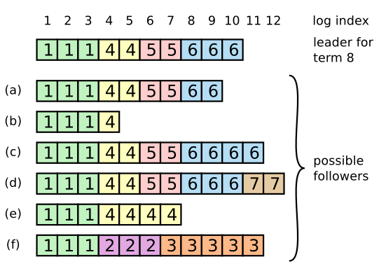

### Suppose we have the scenario shown in the Raft paper's Figure 7: a cluster of seven servers, with the log contents shown. The first server crashes (the one at the top of the figure), and cannot be contacted. A leader election ensues. For each of the servers marked (a), (d), and (f), could that server be elected? If yes, which servers would vote for it? If no, what specific Raft mechanism(s) would prevent it from being elected?

- server (a) could win an election with votes from (b)+(e)+(f) (+ itself == 4 votes == majority)
  - (c) and (d) would not grant votes because of the up-to-date log rule.

- server (d) would win with votes from all others (last log entry has the highest term)

- server (f) would receive zero votes (last log entry has term smaller than any other server)